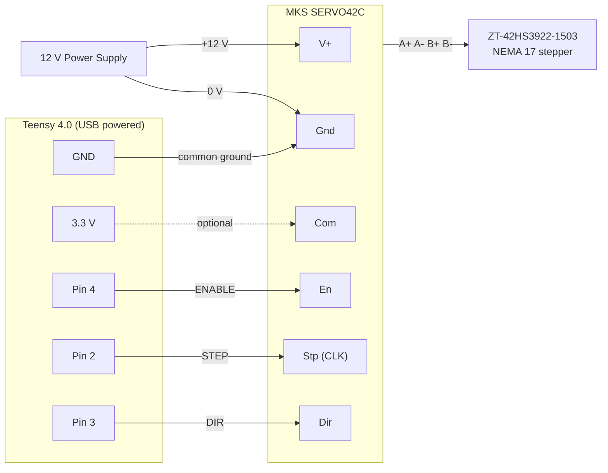

# Motor Wiring – MKS SERVO42C + Teensy 4.0

## Components

| Part | Model | Notes |
|---|---|---|
| Closed-loop driver | MKS SERVO42C (-MT) | Mounted on back of motor, magnetic encoder, OLED menu |
| Stepper motor | ZT-42HS3922-1503 | NEMA 17, 1.8° (200 steps/rev), ~1.5 A |
| Microcontroller | Teensy 4.1 | **3.3 V logic – not 5 V tolerant** |
| Power supply | 12 V DC | Powers the SERVO42C / motor only |

## Diagram

## Pin Table

| SERVO42C pin | Breakout label | Connect to | Notes |
|---|---|---|---|
| V+ | VIN | 12 V supply **+** | 12–24 V allowed |
| Gnd | GND | 12 V supply **−** **and** Teensy GND | Common ground is required |
| Com | VCC | *not connected* | Signal input common. Reads ~3 V floating. If steps are missed, connect to Teensy 3.3 V |
| En | EN | Teensy pin 4 | Ignored while menu `En = Hold` |
| Stp | CLK | Teensy pin 2 | Step pulses |
| Dir | DIR | Teensy pin 3 | HIGH/LOW selects direction |

The motor coils (A+, A−, B+, B−) connect to the SERVO42C through the 4-pin connector on top.

## Rules

- Power the Teensy over **USB only**. Never connect it to the 12 V supply.
- Never apply 5 V to any Teensy pin.
- Teensy GND and supply GND must be connected.

## BNO085 IMU (Adafruit, I2C)

Mounted rigidly on the frame next to the motor mount, so it measures the frame pose.

| BNO085 pin | STEMMA QT wire | Teensy 4.0 | Notes |
|---|---|---|---|
| VIN | red | 3.3 V | Board has its own regulator, 3.3 V is fine |
| GND | black | GND | |
| SDA | blue | pin 18 (SDA0) | `Wire`, 400 kHz |
| SCL | yellow | pin 19 (SCL0) | |
| RST | grey | pin 17 | Hardware reset, used by the library |
| INT | purple | pin 16 | Wired but unused, never driven |

I2C address `0x4A` (`0x4B` if the address jumper is bridged). BT, P0, P1, DI, CS and 3Vo stay unconnected.

**Known issue:** after uploading a new sketch the BNO085 sends no data (even though `begin_I2C` succeeds) until the USB cable is unplugged and replugged. A cold start works. The reset pin is verified working, so the cause is the BNO state after an upload. Workaround: replug USB after each upload.

## Light barrier (index sensor, main axis)

One pulse per lidar-shaft revolution, used for homing and the `E` index edge.

| Wire | Teensy | Notes |
|---|---|---|
| red (power) | 3.3 V | Not 5 V: the Teensy input is not 5 V tolerant |
| black (GND) | GND | |
| green (signal) | pin 5 | `INPUT_PULLUP`, interrupt on the FALLING edge (output goes LOW at the index) |

## Velodyne VLP-16 GPS simulation (`gps_sim/`)

The Teensy imitates a GPS receiver so the VLP-16 timestamps share one clock with the IMU. Simulated time starts at 2000-01-01 00:00:00 UTC at Teensy boot.

| Signal | Jumper colour | Velodyne GPS pin | Teensy 4.1 pin | Notes |
|---|---|---|---|---|
| PPS | green | 1 | pin 10 | 3.3 V, 10 ms pulse every second, rising edge = top of the second |
| GND | white | 3 | GND | |
| NMEA | yellow | 4 | pin 1 (TX1, `Serial1`) | `$GPRMC` at 9600 baud 8N1, sent 100 ms after each PPS edge |

`Serial1` is a hardware UART separate from the USB port (`Serial`), so programming and the PC data stream are not affected. The Teensy 4.1 has Serial1 to Serial8.

## Control sketch `lidar_ctrl/` and USB protocol

The old host test tool (`tools/lidar_tool.ps1`) was removed in the cleanup; it is in git history at commit `4cd3fc0`.

**Sequence:** power-up homes the axis to 0° and holds. Then idle until the config line `C,<rpm>,<unix_seconds>\n` arrives (rpm 1..20; `unix_seconds` = UTC label of the first PPS pulse, which fires 1 s after the line). PPS + NMEA + the data stream start immediately, the axis starts turning 10 s later and keeps going. `x` ramps down, runs on to the next index edge and stops at 0°. PPS, NMEA and the stream keep running. A new `C` is accepted only while the axis is not rotating.

All data share one clock: the simulated UTC time that the PPS/NMEA output uses. USB output never blocks: if nobody reads, packets are dropped and `drops` counts up (only changes in `drops` matter).

**Framing** (little endian): `0xA5 | type u8 | len u8 | payload | crc16`, CRC-16/CCITT-FALSE (init 0xFFFF, poly 0x1021) over type, len and payload.

| Type | When | Payload |
|---|---|---|
| `H` | stream start, then every 10 s | u8 version(1), f32 steps_per_rev, f32 vertical_after_edge_deg, f32 rpm, u32 first_pulse_unix_s |
| `S` | 100 Hz | u64 t_us (unix µs), i32 axis_steps, f32 qw qx qy qz, u16 q_acc (0.01°), u8 cal, f32 lax lay laz (m/s², gravity removed), f32 mx my mz (µT), u8 flags, u8 drops (57 B) |
| `E` | once per index edge | u64 t_us, i32 steps_before_reset (≈ steps_per_rev, deviation = belt slip; meaningless for the first edge after a start) |
| `M` | rare | ASCII text (status / errors) |

- `cal`: bits 0–1 = rotation vector accuracy status (0–3), bits 2–3 = magnetometer status (0–3). The magnetometer needs a figure-8 calibration before the heading is meaningful.
- `flags`: bit 0 = homed, bit 1 = axis running.
- `lax..laz` and `mx..mz` are NaN until the first report arrives.
- `axis angle [deg] = fmod(axis_steps * 360 / steps_per_rev − vertical_after_edge_deg, 360)`, made positive. `axis_steps` is re-zeroed at every index edge.
- The rotation vector is the north-referenced one (uses the magnetometer).

## SERVO42C Menu Settings

| Setting | Value | Notes |
|---|---|---|
| Cal | done | Calibrate with nothing on the shaft |
| Mode | CR_vFOC | Closed loop, step/dir input |
| Ma | ~1200 mA | Below the 1.5 A motor rating |
| MStep | 16 | **Must match `MICROSTEPS` in the firmware** |
| En | Hold | Driver always enabled |

## OLED Status Screen

| Line | Meaning |
|---|---|
| `-46.4K°` | Accumulated shaft angle in degrees (sign = direction) |
| `1.64err` | Position error in degrees (target vs. encoder). A growing value means lost steps |
| `<-99Kclk` | Step pulses received (sign/arrow = direction) |
